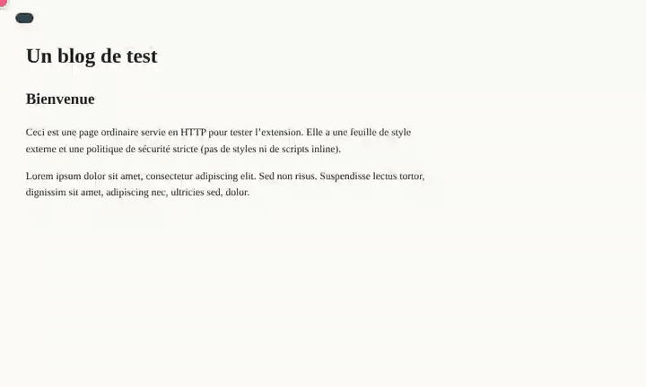
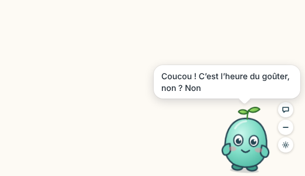
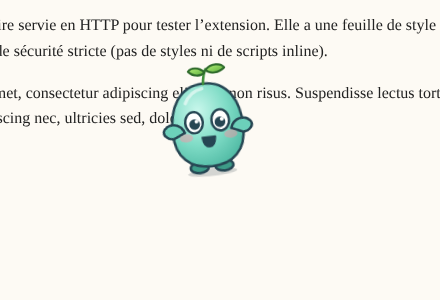
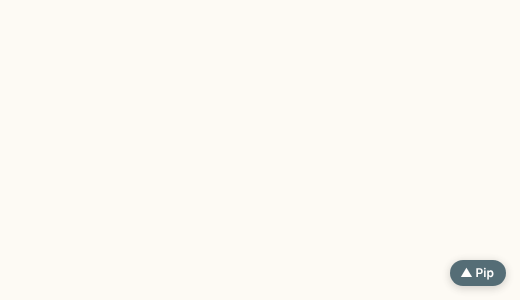
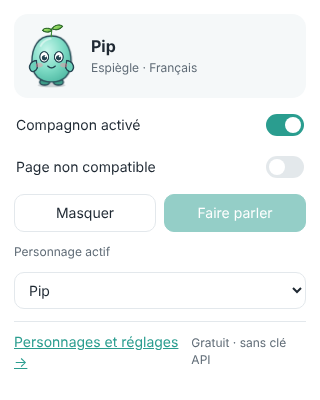
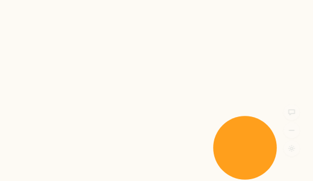
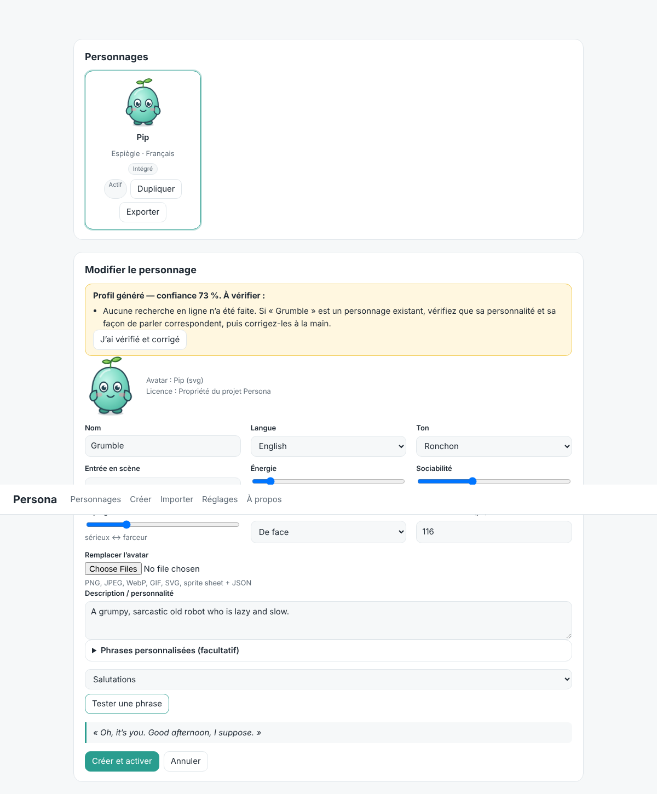

# Persona — compagnon animé

Un petit compagnon virtuel, vivant et personnalisable, qui apparaît sur vos pages web, vous salue et vit
sa vie en bas de la fenêtre. **Gratuit, sans compte, sans abonnement, sans clé API** : les animations et les
répliques tournent entièrement sur votre appareil.



<sub>Démonstration enregistrée automatiquement dans Chromium avec l'extension réelle (`npm run demo`). Le point rose représente la souris.</sub>

| Salutation | Glisser-déposer | Masqué |
|---|---|---|
|  |  |  |

| Menu de l'extension | Avatar importé (SVG) | Création de personnage |
|---|---|---|
|  |  |  |

Deux hôtes réutilisent le même moteur : **extension Chrome (Manifest V3)** et premier **MVP Windows
avec Tauri 2**. Le guide de [lancement Windows](docs/WINDOWS.md#2-application-de-bureau-windows-mvp)
décrit les outils requis et la validation native à effectuer sur un PC Windows.

La branche `feat/desktop-connected-agent` (0.4) ajoute le serveur Persona, la connexion
par appareil, une boucle modèle/outils/résultats, un journal et l’arrêt des tâches, ainsi
qu’une lecture vocale système optionnelle. **Le fournisseur et l’hébergement IA ne sont
pas encore activés.** [Fonctions, adaptation de Capri et mise en route](docs/AGENT-SERVICE.md).

Sur la branche `feat/desktop-chat-and-media`, la bêta Windows 0.3 ajoute une **bulle de saisie au clic**,
une commande de pause média Windows et l’import des animations existantes depuis l’atelier.
La conversation IA, l’animation réaliste depuis une photo et les appels Discord restent à connecter.
Voir le [guide et les limites de 0.3](docs/DESKTOP-CHAT-V03.md).

## Ce que fait le compagnon

- **Entrée en scène** : il sort de derrière le bord de la fenêtre, arrive en sautant ou apparaît dans des étincelles.
- **Salutation** dans une bulle, selon sa **personnalité** (ton), sa **langue** (fr, en, es, de), **l'heure**
  (matin, après-midi, soir, nuit) et le week-end. S'il vous a vu il y a peu, il dit juste « re-coucou » (ou rien
  si vous ouvrez plusieurs pages d'affilée).
- **Il vit sa vie** : respire, cligne des yeux, suit le curseur du regard, regarde autour de lui, fait coucou,
  se promène, saute, fait des remarques, s'endort quand vous ne faites rien et se réveille à votre retour.
  Un personnage énergique bouge plus, un personnage bavard parle plus.
- **Réactions** : cliquez dessus (gigote, saute, tourne sur lui-même, rougit) ; cliquez trop et la tête lui tourne.
- **Déplacer** : glissez-le, il pendouille puis retombe en bas de la fenêtre. Sa position est mémorisée.
  Au clavier : Tab pour le sélectionner, flèches pour le déplacer, Entrée pour interagir.
- **Masquer** : bouton « – » au survol, ou `Alt + Maj + P`. Une petite pastille permet de le faire revenir.
- **Désactiver** : partout ou sur un site, depuis l'icône Persona de la barre d'outils.
- **Personnages** : créer un profil à partir d'une description, importer un avatar, exporter / importer des packs.

## Installer (développement)

Prérequis : Node.js 20+ et Chrome 116+ (ou Edge, Brave…).

```bash
npm ci
```

```bash
npm run build
```

Puis dans Chrome : `chrome://extensions` → **Mode développeur** → **Charger l'extension non empaquetée** →
dossier `dist/extension`. Une page de bienvenue s'ouvre et Pip y apparaît ; il est aussi injecté dans les
onglets http/https déjà ouverts.

Instructions détaillées pour Windows (PowerShell, Edge, zip, tests) : [`docs/WINDOWS.md`](docs/WINDOWS.md).

| Commande | Rôle |
|---|---|
| `npm run build` | Compile l'extension (`dist/extension`) et le bac à sable web (`dist/playground`). |
| `npm run watch` | Recompile à chaque modification. |
| `npm run desktop:dev` | Lance le compagnon de bureau avec Tauri 2 (prérequis natifs requis). |
| `npm run desktop:frontend` | Compile uniquement l’interface de bureau. |
| `npm run desktop:build` | Compile l’application Windows et son installeur NSIS. |
| `npm run test:desktop` | Vérifie l’adaptateur de bureau dans un navigateur, sans valider le comportement natif Windows. |
| `npm run typecheck` | Vérifie les types TypeScript. |
| `npm test` | Tests unitaires (Vitest). |
| `npm run test:e2e` | Tests de bout en bout dans un vrai Chromium avec l'extension chargée (Playwright). Captures dans `test-results/`. |
| `npm run pack` | Zip prêt à distribuer dans `release/`. |
| `npm run verify:package` | Recrée le zip, le décompresse, vérifie le manifest et ses fichiers, puis le charge dans Chromium. |
| `npm run demo` | Réenregistre `docs/demo.gif` (nécessite ffmpeg). |
| `npm run icons` | Régénère les icônes à partir du SVG de Pip. |

Les tests e2e ont besoin du Chromium de Playwright : `npx playwright install chromium` (une fois).

## Personnages

Le personnage de démonstration **Pip** est un esprit-pousse original créé pour ce projet
(`characters/pip/`). Dans **Personnages et réglages** (icône Persona → lien en bas) :

- **Créer** : nom + description → profil déduit localement (ton, traits, langue), avec un **niveau de
  confiance et la liste des incertitudes** (aucune recherche en ligne effectuée, langue devinée, ton non
  identifié…). Corrigez à la main, testez une phrase, enregistrez. Le résultat est mis en cache.
- **Importer** : PNG, JPEG, WebP, GIF (animés joués), SVG (articulé ou non), sprite sheet + JSON (grille
  Persona, Aseprite, TexturePacker), pack `.persona.json`. Détails : [`docs/AVATAR-FORMATS.md`](docs/AVATAR-FORMATS.md).
- **Éditer** : nom, langue, ton, énergie / sociabilité / espièglerie, entrée en scène, phrases personnalisées
  par situation et par moment de la journée (`{user}`, `{,user}`, `{day}`, `{time}`, `{site}`).

## Architecture

Le moteur n'est lié à aucun personnage ni à Chrome :

| Brique | Dossier |
|---|---|
| Character Profile (identité, langue, traits, répliques) | `src/core/profile` |
| Animation Engine (comportement, déterministe) | `src/core/animation` |
| Avatar Assets (formats, import, sécurité SVG) | `src/core/avatar` |
| Chrome Host (content script, popup, options, service worker) | `src/hosts/chrome` |
| Windows Host (MVP Tauri 2) | `src/hosts/windows`, `src-tauri`, [`docs/WINDOWS.md`](docs/WINDOWS.md) |
| Agent Interface (contrat des futures tâches IA, inactif) | `src/core/agent` |
| Scène web partagée par les hôtes | `src/stage` |

Plus de détails : [`docs/ARCHITECTURE.md`](docs/ARCHITECTURE.md).

## Vie privée et permissions

- Les données restent locales : `chrome.storage.local` pour l’extension ; stockage de la WebView et
  configuration locale pour Windows. Aucune synchronisation automatique entre les deux hôtes.
- `host_permissions` http/https : afficher le compagnon dans les pages et l'injecter dans les onglets déjà
  ouverts à l'installation. Le compagnon ne lit pas le contenu des pages (seul le nom du site peut apparaître
  dans une réplique).
- Fonctionne aussi sur les sites à politique de sécurité stricte (CSP) : styles via feuilles construites dans
  un shadow root, images décodées localement sur un canvas.
- Pages non couvertes : pages internes du navigateur, Chrome Web Store, PDF, `file://`.

## Références et licences

Les projets [capri-desktop](https://github.com/lachydotmcg/capri-desktop) (PolyForm Noncommercial) et
[capri-companion](https://github.com/TheAgencyMGE/capri-companion) (code MIT, modèle de personnage dérivé d'une
œuvre protégée) ont été audités : **aucun code ni asset n'en est repris**. Voir
[`docs/AUDIT-REFERENCES.md`](docs/AUDIT-REFERENCES.md).

Aucune licence n'est encore choisie pour ce dépôt : tous droits réservés tant que ce n'est pas décidé.

## Feuille de route

Free : compagnon et animations (extension et premier hôte Windows). Ensuite : tâches d’agent IA et
profils enrichis par IA ; Premium : voix, IA locale, personnalisation avancée. Aucun paiement n'est
implémenté — les paliers sont seulement étiquetés dans `src/core/agent/agent.ts`.

Le parcours Windows accepte 1 à 10 images de référence et conserve un mode instantané local ;
la génération IA et le rigging restent à connecter. Voir [la phase 1 de l’atelier](docs/PHASE1-WORKSHOP.md)
pour l’intégration, les limites et les vérifications Windows, et [le menu initial](docs/DESKTOP-CREATION.md)
pour son historique.

Les changements de la version 0.2 (marche native sur le bureau, prototype de rebords, jauges,
liens d’identité non vérifiés et profil de répliques confirmé) sont détaillés dans
[DESKTOP-CONTEXT-V02.md](docs/DESKTOP-CONTEXT-V02.md). La reconnaissance visuelle IA, les pouvoirs
et Discord ne sont pas encore connectés.
