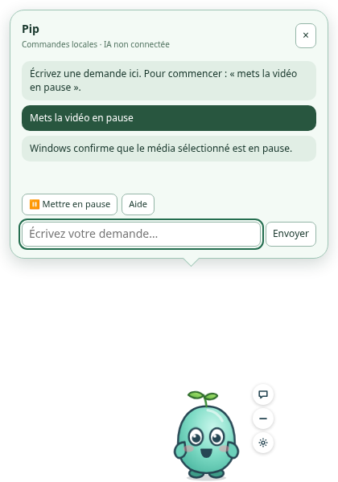

# Persona Windows 0.3 — bulle de saisie et animations importées

Branche : `feat/desktop-chat-and-media`, à partir de la bêta 0.2 existante.
Pas de fusion, de déploiement ni de release publique.

[Télécharger et installer la bêta Windows 0.3.0](INSTALLER-WINDOWS.md).

Validation du commit `fed2f0a` : 119 tests unitaires, 34 tests bureau, 7 tests Rust et
15 tests Chrome E2E. Les workflows
[Windows](https://github.com/TanguyGrd/persona/actions/runs/42690431986) et
[Chrome/Linux](https://github.com/TanguyGrd/persona/actions/runs/42690432065) ont réussi,
y compris la génération de l’installeur NSIS. Les essais interactifs natifs ci-dessous
restent à effectuer.

## Communiquer avec le compagnon

Cliquez brièvement sur le personnage, ou utilisez le bouton de conversation au survol.
Au clavier, sélectionnez le personnage avec Tab puis Entrée ou Espace. Une bulle avec
champ de saisie s’ouvre ; Entrée envoie, Échap ou × ferme la bulle. Un glissement de plus
de 6 pixels déclenche le déplacement natif, sans ouvrir la conversation.

La fenêtre passe temporairement de 360 × 320 à 420 × 600 pixels logiques, dans la zone
utile du moniteur. Fermer la bulle restaure sa taille et sa position précédentes.
Les zones transparentes hors des éléments interactifs restent traversables à la souris.
Les déplacements autonomes sont suspendus pendant la saisie. Les messages restent en
mémoire pour la session du personnage ; aucun message n’est envoyé à un serveur.



Cette capture vient d’un test du frontend avec réponse média simulée ; elle ne prouve
pas la pause d’un lecteur Windows.

**Ce champ n’est pas encore un chat IA.** L’interface affiche « Commandes locales · IA
non connectée ». Les commandes reconnues sont bornées, sans exécution partielle d’une
instruction composée, sans terminal, URL arbitraire ni capture de l’écran.

- « Mets la vidéo en pause », « Mets ma musique en pause » ou le bouton ⏸.
- « Aide » / « Que peux-tu faire ? » explique les fonctions disponibles.
- Les demandes Discord sont refusées explicitement : aucun appel/message/écoute simulé.
- Les autres messages indiquent que la conversation IA n’est pas connectée.

### Pause média

La commande Rust utilise l’API Windows
[`GlobalSystemMediaTransportControlsSessionManager`](https://learn.microsoft.com/uwp/api/windows.media.control.globalsystemmediatransportcontrolssessionmanager)
et `TryPauseAsync` sur la session sélectionnée par Windows. Elle ne lit ni titre de vidéo,
ni contenu de fenêtre, ni audio. Elle n’envoie ni barre Espace ni touche basculant lecture/pause.
Elle ne reprend donc pas volontairement un média déjà en pause.

La réponse distingue : déjà en pause, aucun média, lecteur non en lecture, refus du lecteur,
pause acceptée mais non confirmée, ou état « Paused » effectivement renvoyé par Windows.
Ce choix concerne le média sélectionné par Windows, pas nécessairement la vidéo visible
si plusieurs lecteurs sont ouverts. Les lecteurs n’exposant pas cette API ne sont pas contrôlés.

**La compilation Windows vérifie la liaison de l’API. Aucun essai interactif avec YouTube,
VLC ou Spotify sur un PC Windows n’a encore été effectué dans cet environnement.**

## Fond transparent et véritable cycle de marche

Une image de ville avec un personnage au milieu s’affiche comme une image de ville.
Il faut un personnage détouré avec canal alpha, par exemple en PNG ou WebP. Enregistrer
une image opaque en PNG ne supprime pas le décor. Un damier dans l’aperçu aide à distinguer
les zones transparentes. Recadrez aussi l’image autour du personnage pour qu’il occupe
bien son cadre. Aucun détourage IA n’est effectué.

Une photo isolée n’offre pas de poses de jambes. Pour une animation déjà préparée :

1. Ouvrez **Mes compagnons · Créer**, puis **J’ai déjà une animation ou un pack Persona**.
2. Sélectionnez ensemble l’image PNG/WebP de la planche et son JSON (grille Persona,
   Aseprite ou TexturePacker), ou un fichier `.persona.json` seul.
3. Le personnage importé est enregistré et activé. Un clip `walk` contenant plusieurs
   poses est joué par le moteur pendant ses activités de marche.

Le moteur et les formats restent ceux de `src/core` et `src/stage`. Voir
[AVATAR-FORMATS.md](AVATAR-FORMATS.md) pour créer une planche. Limites : 512 frames,
2048 indices par clip, images 8192 pixels par côté / 16 mégapixels, 8 Mio par image,
48 Mio par JSON de pack. Les dimensions réelles et les clips des packs sont vérifiés
avant d’enregistrer ou d’afficher les assets. L’import ne remplace pas un profil existant.
Pour Aseprite/TexturePacker, exportez sans rotation des frames et sans découpage automatique
des marges (trim), qui ne sont pas reconstruits par le moteur actuel.

Cela ne fabrique pas un cycle réaliste pour Terry à partir d’une seule image. La préparation
automatique (détourage, séparation des parties, création des poses et vérification visuelle)
reste à développer avec un service adapté. Plusieurs références statiques ne sont pas
automatiquement des frames d’animation.

## Capri et agent autonome

Le README et `LICENSE.md` de
[Capri Desktop](https://github.com/lachydotmcg/capri-desktop) ont été revérifiés : licence
PolyForm Noncommercial 1.0.0 avec notice d’attribution. Leur intégration dans le produit
commercial envisagé demande l’accord des ayants droit. Aucun code, personnage, voix
ni animation Capri n’a été copié. L’interface de conversation, le contrôle média et les
adaptations d’import de cette branche sont des implémentations Persona.

Les mécanismes utiles à prévoir sont distincts : interface de conversation, fournisseur
IA derrière un serveur, outils bornés, résultat observé après chaque action, capture
éventuelle autorisée, intégration vocale et gestion des identités. Un agent dans un
navigateur séparé ne rejoint pas à lui seul un appel Discord ouvert sur le PC de l’utilisateur.
Persona n’a aujourd’hui ni agent navigateur autonome, ni connexion vocale Discord,
ni service IA intégré sans clé utilisateur. Aucun achat ou appel de service payant n’est lancé.

## Lancer et vérifier depuis le code

Sur Windows, installer les [prérequis Tauri](WINDOWS.md#2-application-de-bureau-windows-mvp)
(Node.js 22+, Rust MSVC, Visual Studio Build Tools C++, WebView2), puis dans ce checkout :

```powershell
npm ci
npm run desktop:dev
```

Construire l’installeur : `npm run desktop:build`. Il apparaît dans
`src-tauri/target/release/bundle/nsis/`. Pour une installation existante, quitter Persona
depuis l’icône près de l’horloge avant d’installer la nouvelle version.

Vérifications :

```powershell
npm run typecheck
npm test
npx playwright install chromium
npm run test:desktop
npm run desktop:test:native
npm run desktop:frontend
npm run build
npm run pack
npm run verify:package
npm run test:e2e
```

Les tests Chromium du bureau simulent le pont Tauri. Ils contrôlent le clic, la saisie,
le focus, les erreurs, les réponses média, les demandes Discord refusées, l’import et la
persistance d’un vrai fichier d’animation et le changement effectif des pixels de ses frames
avec transparence. Ils ne prouvent pas une interaction native Windows ni une marche réaliste.
La suite Chrome conserve son comportement au clic : la bulle de saisie est propre à l’hôte Windows.

Essai manuel Windows restant : installer le nouvel EXE ; cliquer et saisir ; déplacer le
personnage ; fermer la bulle près des bords de plusieurs écrans/DPI ; cliquer à travers les
zones vides ; lancer une vidéo, demander la pause et vérifier le lecteur ; recommencer avec
un média déjà en pause et aucun média ; masquer/réafficher/quitter depuis la zone de notification.
